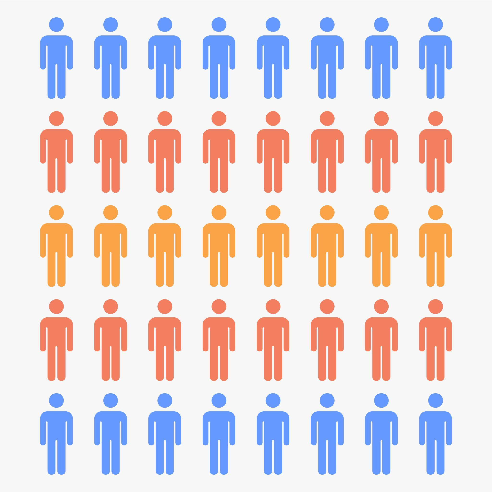
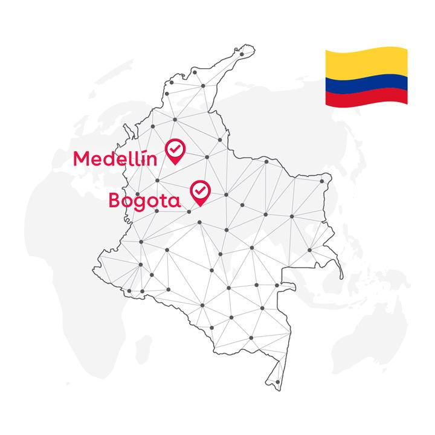
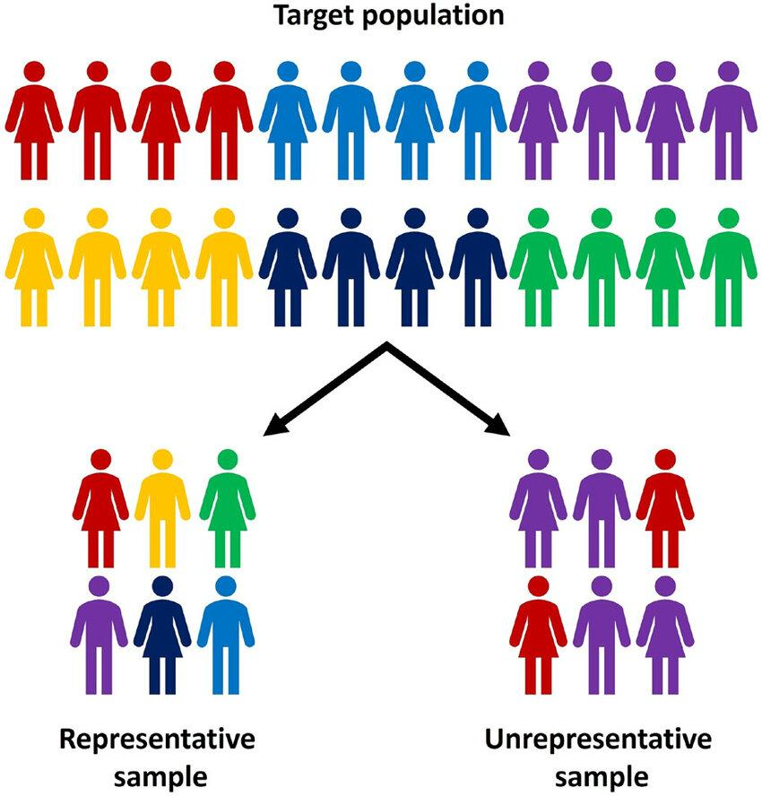
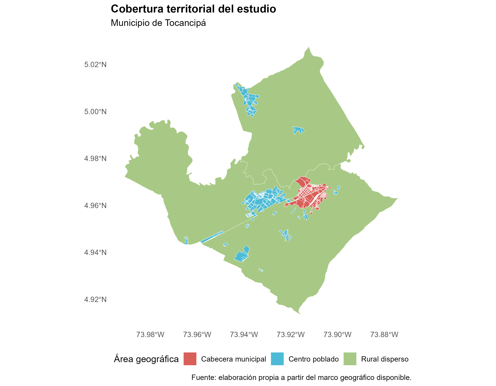
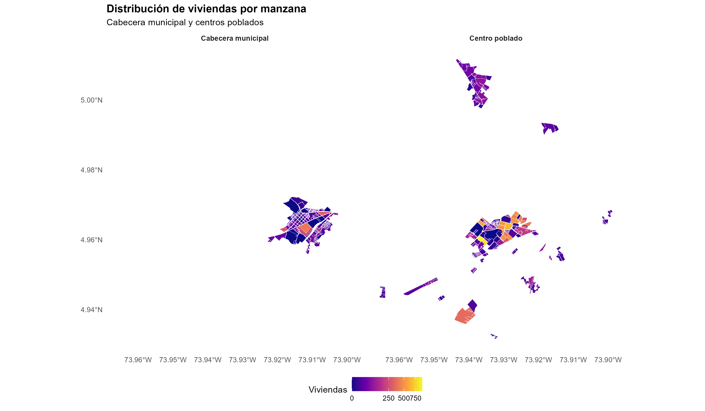
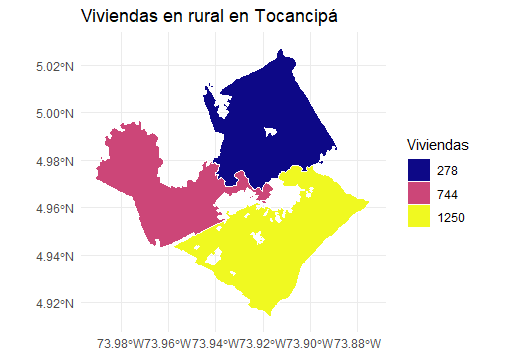
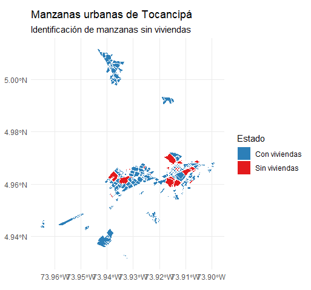
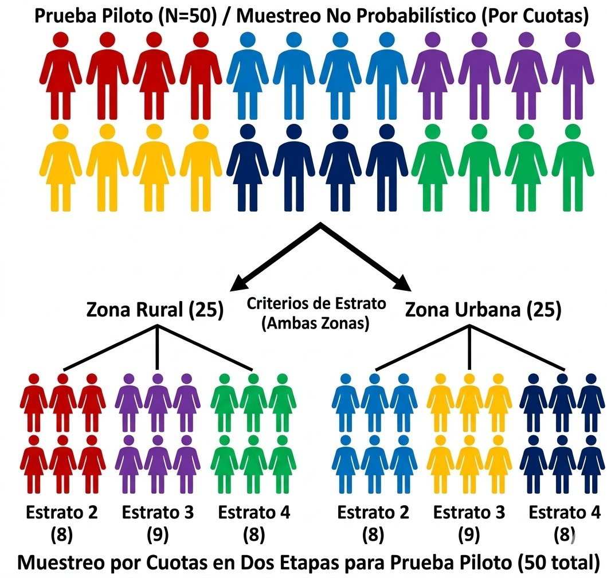

---
---
title: "Muestreo en Tocancipá"
author: "María Paula Camargo Rincón Ana María Chacon Bello"
format:
  html:
    theme: flatly
    toc: true
    toc-location: left
    number-sections: true
    code-fold: hide
    html-math-method: mathjax
    css: styles.css
---

# Diseños probabilísticos 

**¿Qué significa que sea probabilístico?**

Un diseño probabilístico es cuando todos los elementos de la población tienen probabilidad de selección conocida y estrictamente positiva para todos los elementos de la población objetivo.

**¿Qué ventajas hay frente a un diseño no probabilístico?**

permite realizar inferencias estadísticas sobre la población objetivo y cuantificar la incertidumbre del muestreo

**Ejemplo de su importancia**

Imaginemos que queremos estudiar el acceso a educación superior para Colombia, luego por temas de costos y dificultad, así tambien como en posibles casos de seguridad, se decide estudiar o hacer un muestre en Bogotá y Medellín para representar toda Colombia, además de esto dentro de estas ciudades pudieron solo obtener respuesta o encuestar a personas de estrato 4,5 y 6. Los resultados muestran que mas del 70% pueden acceder a la eduación superior en este estudio, pero esto es una lupa a un caso espcífico en la población, no se esta viendo que pasa con las personas en zonas rurales o incluso a personas de otros estratos socioeconomicos. 

Si el estudio pretende representar a toda Colombia, las personas excluidas tienen probabilidad de inclusión cero. Si la población objetivo se hubiera definido desde el principio como residentes de ciertos sectores de Bogotá y Medellín, en cambio, el estudio podría ser válido para esa población más limitada.

# Propuestas

::: {.panel-tabset}

# Probabilísticas

::: {.panel-tabset}

## Todo tocancipá

Actualmente, contamos con un marco geográfico de manzanas para la cabecera municipal y los centros poblados de Tocancipá. Para el área rural dispersa, en cambio, disponemos de secciones rurales, pero no de un marco desagregado por veredas que incluya la información auxiliar necesaria para el diseño muestral.

Es importante aclarar que la delimitación geográfica de las veredas podría obtenerse mediante fuentes como la Alcaldía de Tocancipá. Sin embargo, el principal reto no consiste únicamente en identificar estas unidades en el territorio, sino en obtener una estimación confiable del número de viviendas en cada una de ellas.

Esta información es relevante porque se propone utilizar el número de viviendas como variable auxiliar para la selección de las unidades de primera etapa mediante un diseño de probabilidad proporcional al tamaño (PPT), diferenciando dos estratos geográficos: urbano y rural disperso.

**¿Por qué representa una dificultad disponer de secciones rurales en lugar de veredas?**

El procedimiento de muestreo propuesto contempla la selección de unidades geográficas en una primera etapa y la selección sistemática de viviendas en una segunda etapa. Dado que no se dispone de un listado actualizado de viviendas por unidad geográfica, se requiere que los encuestadores realicen un recorrido de enumeración en las unidades seleccionadas, con el fin de identificar las viviendas existentes, actualizar el marco y construir el listado necesario para seleccionar la muestra de viviendas.

En el área urbana, este procedimiento puede implementarse a partir de manzanas delimitadas, cuya extensión territorial permite realizar recorridos relativamente acotados. En cambio, en el área rural dispersa, las unidades disponibles corresponden a secciones geográficas que pueden abarcar extensiones considerables, dentro de las cuales las viviendas se encuentran dispersas.

En consecuencia, enumerar todas las viviendas de una sección rural seleccionada podría implicar desplazamientos prolongados, mayores requerimientos de personal y transporte, y un incremento significativo de los costos y tiempos de trabajo de campo.

Por tanto, la dificultad no radica en que el muestreo probabilístico rural sea imposible, sino en que la aplicación del mismo procedimiento de enumeración utilizado en las manzanas urbanas puede resultar operativamente inviable. Antes de incorporar el área rural dispersa, sería necesario evaluar la extensión de las unidades, la distribución de las viviendas y la viabilidad de construir un marco actualizado mediante un procedimiento de campo adecuado.

**Solución**

complementar el marco geográfico disponible con unidades territoriales adecuadas y una variable auxiliar que permita cuantificar el tamaño de las unidades de primera etapa, tanto en el estrato urbano como en el rural. Se evaluarán variables como el número de viviendas, el número de hogares o la población residente, según su disponibilidad, calidad y pertinencia para el diseño PPT. Posteriormente, en las unidades seleccionadas, se realizaría la enumeración de viviendas necesaria para construir el marco operativo y seleccionar sistemáticamente las viviendas que participarán en el estudio.

## Areas seleccionadas

Como se mencionó en el ejemplo anterior, una alternativa consiste en delimitar la población objetivo a la cabecera municipal y los centros poblados de Tocancipá, teniendo en cuenta que actualmente se dispone de información para construir el marco muestral de estas áreas.

En este escenario, el diseño probabilístico permitiría realizar inferencias estadísticas sobre la población residente en la cabecera municipal y los centros poblados, siempre que se garantice una cobertura adecuada y se controlen, en la medida de lo posible, los problemas asociados a la no respuesta.

**Es importante aclarar que los resultados no se extrapolarían a la totalidad de Tocancipá**, puesto que el área rural dispersa quedaría excluida de la población objetivo. Por tanto, las conclusiones se limitarían a las áreas geográficas incluidas en el diseño.

::: 

# Diseño no probabilístico

Una tercera alternativa consiste en implementar un diseño de muestreo no probabilístico, mediante un muestreo por conveniencia con cuotas. Esta opción permitiría reducir los costos económicos, los tiempos de ejecución y las exigencias operativas del diseño muestral, dado que no sería necesario disponer de un marco muestral completo ni garantizar que cada elemento de la población tuviera una probabilidad conocida de ser seleccionado. De esta manera, la recolección de información podría organizarse de acuerdo con los recursos disponibles y las posibilidades de acceso a las zonas de estudio.

Para esta propuesta, se plantea realizar 50 encuestas en total: 25 en la zona urbana y 25 en la zona rural. Dentro de cada zona se establecerían cuotas por estrato socioeconómico, distribuidas de la siguiente manera:

| Estrato socioeconómico | Zona urbana | Zona rural | Total |
|:-----------------------|------------:|-----------:|------:|
| Estrato 2              | 8           | 8          | 16    |
| Estrato 3              | 9           | 9          | 18    |
| Estrato 4              | 8           | 8          | 16    |
| **Total**              | **25**      | **25**     | **50** |

Esta distribución busca garantizar la participación de personas pertenecientes a los tres estratos socioeconómicos considerados en ambas zonas. Sin embargo, las cuotas propuestas son criterios operativos para organizar la recolección de información y no necesariamente reflejan la distribución real de la población de Tocancipá. La selección de los participantes dentro de cada grupo se realizaría por conveniencia, de acuerdo con su accesibilidad y disposición para responder la encuesta.

La reducción de costos y exigencias operativas implica una limitación importante en el alcance de los resultados. El estudio permitiría describir las características y respuestas de las 50 personas encuestadas, pero no realizar inferencias estadísticas sobre la población de Tocancipá en su conjunto. En este sentido, los resultados corresponderían a una muestra de Tocancipá, no a una descripción necesariamente representativa de Tocancipá. Aunque se incluyan participantes de las zonas urbana y rural y de distintos estratos socioeconómicos, esto no garantiza que la muestra represente adecuadamente a todos los habitantes del municipio.

Por tanto, esta alternativa sería apropiada para una exploración inicial, la identificación de posibles tendencias en las respuestas o la evaluación de la viabilidad del instrumento y del trabajo de campo con un presupuesto limitado. Si el objetivo es obtener estimaciones generalizables a la población municipal y cuantificar su incertidumbre mediante procedimientos de inferencia estadística, sería preferible implementar un diseño probabilístico.

::: 

